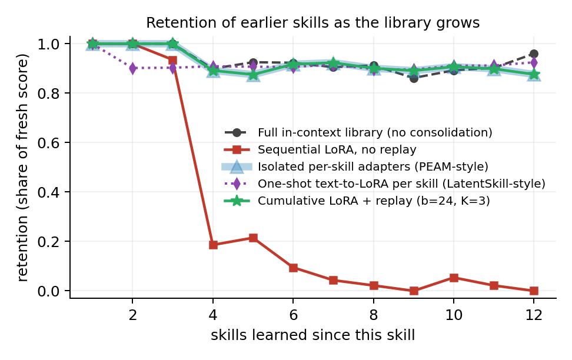
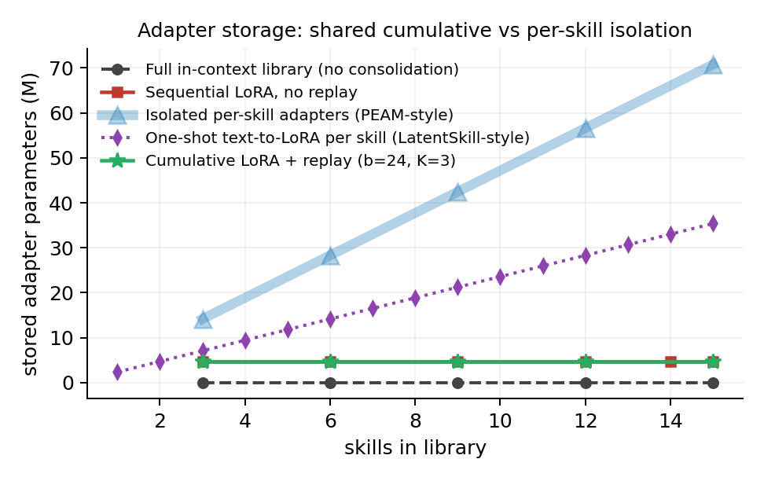

# Sleep-consolidating a growing skill library into a cumulative LoRA

A Voyager-style agent accumulates skills as text/code in a growing library. Every
few completed tasks it "sleeps": new skills become SFT examples, a **capped
replay buffer** of earlier skills is interleaved with them, and one short LoRA
pass folds the mixture into a **single cumulative adapter**. Consolidated skills
then drop out of the prompt, leaving only their names.

The question the project is built to answer is narrow and comparative:

> Can replay into one shared adapter retain a growing skill library as well as
> physically isolating one adapter per skill, without paying for storage that
> grows with every skill learned?

That comparison -- cumulative-plus-replay against PEAM-style isolation, with a
no-replay sequential adapter as the control that proves forgetting is real -- is
the contribution. It is not run in any of the neighbouring papers.

## Results (CPU pipeline, 20 seeds)

| method | final success | oldest 3 skills | prompt tokens | stored params |
|---|---|---|---|---|
| (a) Full in-context library | 0.85 | 0.87 | 856 | 0 |
| (b) Sequential LoRA, no replay | 0.10 | 0.27 | 679 | 4.7 M |
| (c) Isolated per-skill adapters (PEAM-style) | 0.73 | 0.87 | 417 | 70.8 M |
| (d) One-shot text-to-LoRA (LatentSkill-style) | 0.71 | 0.67 | 320 | 35.4 M |
| **ours** -- cumulative LoRA + replay | **0.73** | **0.87** | **417** | **4.7 M** |

The table's token column is the mean across the whole run, when the library is
still small for much of it. At full library size the gap is wider: 1164 tokens
per attempt for the in-context baseline against 353 once skills have been
consolidated, which is what figure 3 shows.

Replay into one shared adapter matches isolation's retention at **15x less
adapter storage**, and cuts prompt cost roughly in half against keeping the
library in context. **That match is true by construction here, not evidence:**
the CPU library never exceeds 15 skills, so a 24-example buffer replays every
skill every night and the simulator then holds each learned skill at retention
1.0, exactly what isolation returns (`tests/test_replay_saturation.py`). In the
simulator, a replay buffer that covers the whole library reproduces isolation
exactly; the informative regime is a library larger than the buffer, which the
library-size sweep (`PROTOCOL_sweep.md`) tests. The stored-parameter column is
about 8% high (grouped-query attention, `docs/sweep_design.md`); the 15x ratio
is unaffected. It does not match the in-context ceiling on absolute success
(0.73 vs 0.85) -- that gap is the price of moving skills out of the prompt, and
it is reported rather than smoothed over.

Without replay the same cumulative adapter collapses to 0.10. That baseline
exists to prove the setup can detect forgetting at all; if it ever stops
collapsing, the result means nothing, which is why it is also a test
(`test_no_replay_forgets_and_replay_does_not`).




## What is real and what is simulated

This matters for reading any number here, so it is stated up front.

| layer | CPU pipeline | GPU run |
|---|---|---|
| environment, skill tree, success checks | real | real |
| skill library, retrieval, token accounting | real | real |
| replay buffer, night scheduling, checkpoints | real | real |
| **the adapter** | **simulated interference model** | **real LoRA on Qwen2.5-1.5B** |
| **recall of a skill** | **sampled from the model** | **measured by decoding** |

The CPU pipeline exists so the whole loop, the metrics and the figures can be
developed and tested without a GPU. Its retention numbers come from an explicit
interference model (`sleep/backend.py`), **not** from gradients, and every
checkpoint records which backend produced it. Headline claims belong to the GPU
notebooks, which run the same loop against a real cumulative LoRA.

## Layout

```
env/          crafting DSL, world executor, 15-task skill tree, reference solutions
library/      the growing skill store, retrieval, token accounting, skill authoring
sleep/        adapter backends (simulated + real LoRA), replay buffer, nights, checkpoints
agent/        policy interface, CPU recall simulator, LM policy, the Voyager loop
baselines/    the four methods as data, CPU runner, resumable GPU runner
analysis/     evaluation, forgetting curves, figures, GPU result collection
configs/      default GPU config, CPU pipeline config, ablation grids
notebooks/    Kaggle notebooks: smoke test, main run, ablations, figures
scripts/      CPU experiments, ablations, figures, notebook generation
tests/        144 tests, CPU only
```

## Running it

```bash
pip install -r requirements.txt

python -m pytest -q                      # 144 tests, about 70 seconds
python scripts/reproduce.py              # every CPU result and figure
python scripts/run_cpu_experiment.py     # the four methods, quick
python scripts/run_ablations.py --grid buffer
```

On Kaggle, run the notebooks in order. `02_main_run.ipynb` is written to be run
repeatedly: it does as many nights as the session allows, checkpoints each one,
and resumes from the last manifest next time.

## The environment

A text-only crafting game: five locations, seven gatherable resources, thirteen
recipes, tool gating (stone needs a wooden pickaxe, iron needs a stone pickaxe)
and two placeable stations. Programs are written in a five-operation DSL and can
call previously-learned skills by name, which is what makes the library
compositional.

```
call(craft_stone_pickaxe)
goto(cave)
gather(iron_ore, 3)
```

There is **no LLM critic**. A task succeeds when a predicate over world state
says it does. That removes the largest cost in Voyager's loop and makes the
success signal exact.

The 15 tasks form a 10-tier tree from `gather_wood` to `craft_lantern`; every
task has a reference solution that is verified from a fresh world in the test
suite, so the tree is known to be solvable before any model is involved.

## Consolidation

A night, in order:

1. collect the skills learned since the last night
2. build one SFT example per skill: task description in, verified program out,
   with no library text in the prompt -- so a correct program can only come from
   weights
3. draw a capped replay sample from everything learned earlier
4. **interleave** new and replayed examples and run one short LoRA pass over the
   mixture
5. keep training the *same* adapter -- never reset, never fork
6. mark the new skills consolidated, so retrieval serves only their names

Steps 4 and 5 are the method. Interleaving rather than concatenating keeps
replay gradients spread through the pass; sharing one adapter rather than
forking is what keeps storage flat.

## Ablations

**Replay budget** saturates as soon as the buffer can cover the library once:
0 -> 0.10, 6 -> 0.45, 12 -> 0.73, and 24 and 48 are no better than 12. A buffer
does not need to grow with the library, it needs to *cover* it. That is the
result that makes a fixed cap defensible rather than a compromise.

**Consolidation frequency** favours fewer, larger nights: K=1 gives 0.71, K=3
gives 0.73, K=5 gives 0.87 while also doing the least work. Consolidating after
every single skill is both the most expensive option and the worst one, which
suggests the self-triggered timing machinery PEAM builds is not load-bearing at
this scale.

**Allocation under a scarce buffer** is the only place the strategy matters at
all; at b=24 every strategy covers the whole library and they are identical, so
this grid runs at b=8, below one example per skill. There, tier-balanced
allocation is clearly best on the oldest skills (0.87, against 0.53 for uniform
and 0.27 for both recency and round-robin). The round-robin default was chosen
for its coverage guarantee and **the ablation does not support it** -- on a
binding budget, spreading replay across tiers beats rotating through skills.

## Honest limitations

- The GPU results are the ones that count, and this repo ships the CPU pipeline
  plus the notebooks to produce them, not the GPU numbers themselves.
- Fifteen skills is a small library. The storage argument against isolation gets
  stronger with scale, but so might interference in a shared adapter; a rank-16
  adapter holding hundreds of skills is not tested here.
- The synthetic environment is defined by the same person evaluating on it. The
  planned check is Crafter's text-observation mode, which is not done.
- Isolation wins on retention robustness by construction. This project argues it
  is not worth linear storage at this scale, not that isolation is wrong.
